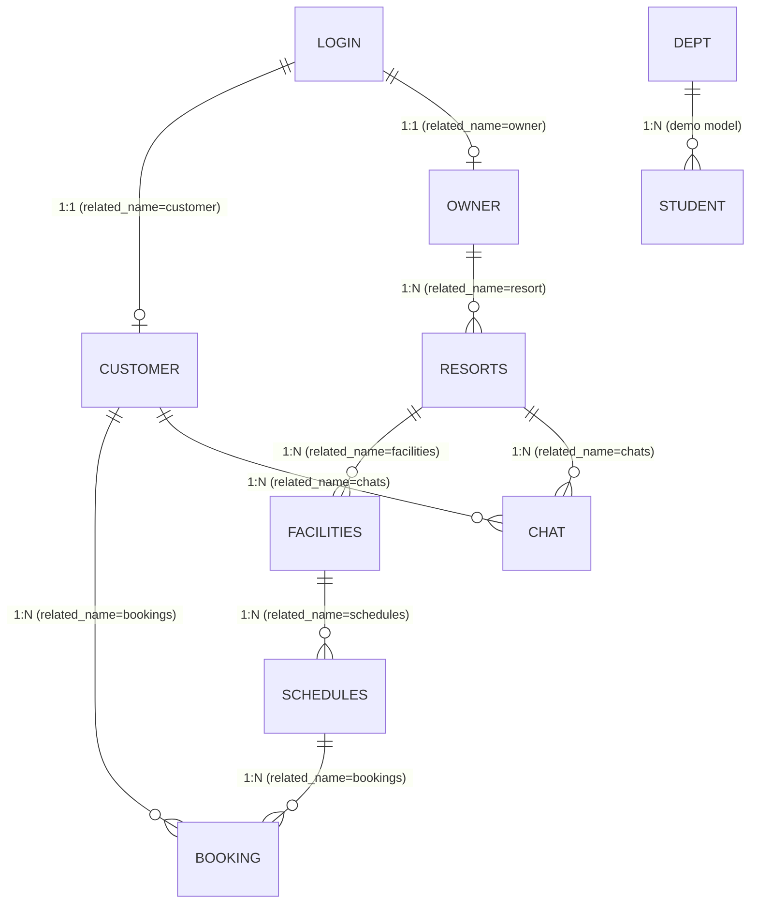

# InnKeeper — Complete Project Documentation

**Project:** InnKeeper (resort / homestay booking platform)
**Repository:** `C:\Users\ABHAY PADMANABHAN\PycharmProjects\InnKeeper`
**Framework:** Django 6.1 · Python 3.13.7 · PostgreSQL
**Repository revision:** commit `8e044d6` ("git push")
**Document generated:** 17 November 2026
**Purpose:** A complete, self-contained technical brief — data model, routes, views,
templates/pages, business rules, known issues — intended to be handed to an AI assistant
(Claude, Gemini, etc.) or a new developer.

---

## Table of contents

1. How to use this document
2. Executive summary
3. Tech stack and dependencies
4. Repository layout
5. Django configuration
6. Data model
   - 6.1 Entity–relationship diagram
   - 6.2 Model reference
   - 6.3 Relationship rules and cascade behaviour
   - 6.4 Migration history
   - 6.5 Demo / legacy models
7. URL and route map
8. Views — detailed behaviour
   - 8.1 Core and authentication views
   - 8.2 Customer views
   - 8.3 Owner views
   - 8.4 Admin views
   - 8.5 Forms
9. Templates and pages
   - 9.1 Page inventory
   - 9.2 Per-page details
10. End-to-end user flows
11. Business rules and status codes
12. UI and design system
13. Static and media files
14. Running the project locally
15. Known bugs and inconsistencies
16. Security and production readiness
17. Suggested improvements
18. Appendix A — Python file inventory
19. Appendix B — Git history
20. Appendix C — Glossary

---

## 1. How to use this document

This file is the single source of truth for the InnKeeper codebase as it exists today.
It is written to be read by a human **or** pasted into an AI assistant.

* Sections 6–9 are the important ones for understanding the system.
* Section 15 lists real defects with file/line references — useful if you are asking an AI to
  "fix the bugs" or "review this project".
* Section 17 lists what is missing if you are asking an AI to "extend this project".
* All statements here were derived by reading the source, not from comments or assumptions.

---

## 2. Executive summary

**InnKeeper** is a Django web application with a **three-role** model:

| Role | Flag on `Login` | What they do |
|------|-----------------|--------------|
| Customer | `is_customer = True` | Browse resorts, view details, book available date slots, see booking history, message resort owners |
| Owner | `is_owner = True` | Register resorts, describe facilities, publish booking slots (date ranges), approve/reject customer bookings, reply to messages |
| Admin / staff | `is_staff = True` | View and delete customers and owners, view all resorts; full access through the stock Django admin |

**Core domain chain:**

```
Login (auth user) -> Owner -> Resorts -> Facilities -> Schedules -> Booking <- Customer
                                 |
                                 +-> Chat <- Customer
```

A resort is described by exactly one `Facilities` record (pool / kitchen / wifi / lawn / balcony
booleans). Each facility owns many `Schedules`, which are the bookable date ranges
(`from_date` … `to_date`). A customer books a schedule, producing a `Booking` whose `status`
goes `0` (pending) → `1` (approved) or `2` (rejected).

**Pages:** a public marketing/landing page with a resort grid, separate customer / owner / admin
dashboard shells (Corona Admin theme), plus form pages built with `crispy_forms`.

**State of the project:** functional prototype / academic project. It runs end-to-end for the main
happy path, but has several real bugs (section 15), no tests, no permissions beyond
`login_required`, and hard-coded development secrets.

---

## 3. Tech stack and dependencies

**Runtime**

| Item | Value |
|------|-------|
| Language | Python 3.13.7 |
| Framework | Django 6.1 |
| Database | PostgreSQL, database `innkeeper_main` at `127.0.0.1:5432` |
| DB driver | psycopg2 2.9.12 |
| Auth | Django's built-in auth with a **custom user model** (`InnKeeper_app.Login`) |
| Templates | Django template language, project-level `templates/` directory |
| Forms | `django-crispy-forms` + `crispy-bootstrap5` |
| Debugging | `django-debug-toolbar` (installed and active) |
| Front-end | Bootstrap 5.3.8 (CDN), Bootstrap 5 (local vendor copy), jQuery, Corona Admin dashboard theme, custom CSS in the landing templates |
| Time zone | `Asia/Kolkata` |

**Exact environment (`pip freeze` from `.venv`)**

```
asgiref==3.12.1
crispy-bootstrap5==2026.9
djangify==1.0.0
Django==6.1
django-crispy-forms==2.7
django-debug-toolbar==8.0.0
psycopg2==2.9.12
sqlparse==0.6.0
tzdata==2026.3
```

> Note: there is **no `requirements.txt`** in the repository; the list above is the
> authoritative dependency set.

---

## 4. Repository layout

```
InnKeeper/
├── manage.py                    Django entry point (settings module: InnKeeper_project.settings)
├── main.py                      PyCharm boilerplate, unused
├── .venv/                       local virtual environment (Python 3.13.7)
├── .idea/                       PyCharm project files
├── .git/
│
├── InnKeeper_project/           project package (configuration)
│   ├── settings.py              all settings (see section 5)
│   ├── urls.py                  root URLconf: /admin/, include(InnKeeper_app.urls), debug toolbar, media
│   ├── asgi.py / wsgi.py        deployment entry points
│
├── InnKeeper_app/               the single Django app
│   ├── models.py                9 models (section 6)
│   ├── views.py                 core/auth views: landing, login, logout, registration, account routing
│   ├── customer_views.py        customer dashboard, profile, booking, chat
│   ├── owner_views.py           owner dashboard, resort CRUD, schedules, approvals, messages
│   ├── admin_views.py           staff dashboard, customer/owner/resort listing
│   ├── form.py                  ModelForms + registration form
│   ├── urls.py                  all application routes (44 patterns)
│   ├── admin.py                 registers models with Django admin
│   ├── apps.py, tests.py        boilerplate (tests.py is empty)
│   └── migrations/              0001 … 0012 (section 6.4)
│
├── templates/                   all HTML
│   ├── Landing.html             public home page + resort grid
│   ├── base_landing.html        public shell with 
│   ├── Login.html               login form
│   ├── customer_page.html       customer registration
│   ├── owner_page.html          owner registration
│   ├── Dashboard.html           Corona Admin generic dashboard (not routed)
│   ├── resort_details.html      resort detail page
│   ├── book_now.html            slot list
│   ├── select_slot.html         booking confirmation
│   ├── booking_success.html     success screen
│   ├── admin/                   admin_base.html + 5 pages
│   ├── customer/                customer_base.html + 5 pages
│   └── owner/                   owner_base.html + 12 pages
│
├── static/                      CSS/JS/vendors (Bootstrap, jQuery, Corona Admin assets, flags, etc.)
└── media/                       user uploads; resorts/pictures/ (13 files)
```

---

## 5. Django configuration (`InnKeeper_project/settings.py`)

**Installed apps**

```python
INSTALLED_APPS = [
    'crispy_forms',
    'crispy_bootstrap5',
    'django.contrib.admin',
    'django.contrib.auth',
    'django.contrib.contenttypes',
    'django.contrib.sessions',
    'django.contrib.messages',
    'django.contrib.staticfiles',
    'InnKeeper_app',
    'debug_toolbar',
]
CRISPY_TEMPLATE_PACK = 'bootstrap5'
```

**Middleware** — the default Django stack plus `debug_toolbar.middleware.DebugToolbarMiddleware`
at the end. `INTERNAL_IPS = ["127.0.0.1"]`.

**Templates** — `DIRS = [BASE_DIR / 'templates']`, `APP_DIRS = True`, context processors:
`request`, `auth`, `messages`.

**Database**

```python
DATABASES = {
    "default": {
        "ENGINE": "django.db.backends.postgresql",
        "NAME": "innkeeper_main",
        "USER": "postgres",
        "PASSWORD": "1234",
        "HOST": "127.0.0.1",
        "PORT": "5432",
    }
}
```

**Auth / security / other**

| Setting | Value | Note |
|---------|-------|------|
| `AUTH_USER_MODEL` | `InnKeeper_app.Login` | custom user model, defined from the start |
| `SECRET_KEY` | hard-coded `django-insecure-...` | development only |
| `DEBUG` | `True` | development only |
| `ALLOWED_HOSTS` | `[]` | works only on localhost under `DEBUG` |
| `LANGUAGE_CODE` | `en-us` | |
| `TIME_ZONE` | `Asia/Kolkata` | `USE_TZ = True` |
| `STATIC_URL` / `STATICFILES_DIRS` | `static/` / `BASE_DIR/static` | |
| `MEDIA_URL` / `MEDIA_ROOT` | `/media/` / `BASE_DIR/media` | served in `DEBUG` only |
| `MAILERS` | console backend | Django 6.x email configuration style |
| Password validators | the four Django defaults | |

**Root URLconf (`InnKeeper_project/urls.py`)**

```python
urlpatterns = [
    path('admin/', admin.site.urls),
    path('', include('InnKeeper_app.urls')),
] + debug_toolbar_urls()

if settings.DEBUG:
    urlpatterns += static(settings.MEDIA_URL, document_root=settings.MEDIA_ROOT)
```

So: Django admin at `/admin/`, debug toolbar at `/__debug__/`, uploaded images at `/media/...`,
and everything else in `InnKeeper_app/urls.py`.

---

## 6. Data model

All models live in `InnKeeper_app/models.py` (90 lines). Django's default `id`
(`BigAutoField`) primary key is used everywhere and is not repeated below.

### 6.1 Entity–relationship diagram

Mermaid (renders on GitHub and in many markdown viewers):



Plain-text version (for tools that do not render Mermaid):

```
Login (AbstractUser)
 ├─1:1─ Customer ──1:N── Booking ──N:1── Schedules ──N:1── Facilities ──N:1── Resorts ──N:1── Owner ─1:1─ Login
 ├─1:1─ Owner
 └─     Chat ──N:1── Resorts
        Chat ──N:1── Customer

dept ──1:N── Student        (unrelated demo models)
```

### 6.2 Model reference

#### `Login` — custom user (table `InnKeeper_app_login`)

Inherits **`AbstractUser`**, so it also has `username`, `password`, `first_name`, `last_name`,
`email`, `is_staff`, `is_active`, `is_superuser`, `date_joined`, `last_login`, `groups`,
`user_permissions`.

| Field | Type | Details |
|-------|------|---------|
| `is_owner` | BooleanField | default `False`; set to `True` during owner registration |
| `is_customer` | BooleanField | default `False`; set to `True` during customer registration |

Role resolution used everywhere: `user.is_customer` → customer dashboard,
`user.is_owner` → owner dashboard, `user.is_staff` → admin dashboard.
A user can technically hold more than one flag; the checks are ordered customer → owner → staff.

#### `Customer`

| Field | Type | Notes |
|-------|------|-------|
| `user` | OneToOneField → `Login` | `on_delete=CASCADE`, `related_name='customer'` |
| `name` | CharField(100) | |
| `phone` | CharField(10) | no country code, no validation beyond length |
| `email` | EmailField | changed from CharField(100) in migration 0002 |
| `address` | CharField(500) | |

`__str__` → `name`.

#### `Owner`

| Field | Type | Notes |
|-------|------|-------|
| `user` | OneToOneField → `Login` | `on_delete=CASCADE`, `related_name='owner'` |
| `name` | CharField(100) | |
| `phone` | CharField(10) | |
| `email` | CharField(100) | intentionally/inconsistently a plain CharField (not EmailField) |

`__str__` → `name`.

#### `Resorts`

| Field | Type | Notes |
|-------|------|-------|
| `owner` | ForeignKey → `Owner` | `CASCADE`, `related_name='resort'` (singular) |
| `name` | CharField(100) | |
| `description` | TextField(max_length=1000) | `max_length` is not enforced at DB level for TextField |
| `address` | CharField(500) | `null=True, blank=True` |
| `location` | CharField(500) | `null=True, blank=True` |
| `picture` | FileField | `upload_to='resorts/pictures/'`, **required** |
| `pricing` | CharField(500) | a string, not a number (rendered as `₹{{ pricing }}`) |

`__str__` → `name`.

#### `Facilities`

| Field | Type | Notes |
|-------|------|-------|
| `resort` | ForeignKey → `Resorts` | `CASCADE`, `related_name='facilities'` |
| `pool` | BooleanField | default `False` |
| `kitchen` | BooleanField | default `False` |
| `wifi` | BooleanField | default `False` |
| `lawn` | BooleanField | default `False` |
| `balcony` | BooleanField | default `False` |

No `__str__`. In practice **one Facilities row per resort** is assumed (several views call
`Facilities.objects.get(resort=...)`).

#### `Schedules` (bookable date ranges)

| Field | Type | Notes |
|-------|------|-------|
| `facilities` | ForeignKey → `Facilities` | `CASCADE`, `related_name='schedules'` |
| `from_date` | DateField | |
| `to_date` | DateField | no validation that `from_date <= to_date` |
| `schedule_status` | BooleanField | default `0`; used as an integer flag: `0` = available, `1` = taken |

No `__str__`, no ordering.

#### `Booking`

| Field | Type | Notes |
|-------|------|-------|
| `customer` | ForeignKey → `Customer` | `CASCADE`, `related_name='bookings'` |
| `schedule` | ForeignKey → `Schedules` | `CASCADE`, `related_name='bookings'` |
| `status` | IntegerField | default `0`; `0` pending, `1` approved, `2` rejected |
| `time_data` | DateField | `auto_now=True` — stores the date of the **last save** (see section 15) |

No `__str__`. No unique constraint on `(customer, schedule)`.

#### `Chat` (customer → resort message with one owner reply)

| Field | Type | Notes |
|-------|------|-------|
| `resort` | ForeignKey → `Resorts` | `CASCADE`, `related_name='chats'` |
| `customer` | ForeignKey → `Customer` | `CASCADE`, `related_name='chats'` |
| `message` | TextField | customer's text |
| `reply` | TextField | `blank=True, null=True`; owner's single reply |

No `__str__`, no created/updated timestamps, no read/unread state, no message threading.

### 6.3 Relationship rules and cascade behaviour

| Relationship | Cardinality | On delete |
|--------------|-------------|-----------|
| `Login` → `Customer` | 1:1 | deleting the user deletes the customer profile |
| `Login` → `Owner` | 1:1 | deleting the user deletes the owner profile |
| `Owner` → `Resorts` | 1:N | deleting an owner deletes **all** their resorts |
| `Resorts` → `Facilities` | 1:N | deleting a resort deletes its facilities |
| `Facilities` → `Schedules` | 1:N | cascade |
| `Schedules` → `Booking` | 1:N | deleting a slot deletes its bookings |
| `Customer` → `Booking` | 1:N | cascade |
| `Resorts` → `Chat` | 1:N | cascade |
| `Customer` → `Chat` | 1:N | cascade |

Consequence: deleting a resort silently removes its facilities, all schedules, all bookings on
those schedules, and all chat messages about it.

### 6.4 Migration history

| # | Name | What it does |
|---|------|--------------|
| 0001 | `initial` | Creates `Login` (AbstractUser + `is_owner`, `is_customer`), `Customer` (email as CharField), `Owner` |
| 0002 | `alter_customer_email` | `Customer.email` CharField(100) → EmailField |
| 0003 | `resorts_facilities` | Creates `Resorts` and `Facilities` |
| 0004 | `rename_user_facilities_resort` | Renames `Facilities.user` → `Facilities.resort` |
| 0005 | `resorts_address_resorts_location` | Adds `Resorts.address` and `Resorts.location` |
| 0006 | `schedules` | Creates `Schedules` |
| 0007 | `booking` | Creates `Booking` |
| 0008 | `booking_status` | Adds `Booking.status` |
| 0009 | `booking_time_data` | Adds `Booking.time_data` |
| 0010 | `schedules_schedule_status` | Adds `Schedules.schedule_status` |
| 0011 | `chat` | Creates `Chat` |
| 0012 | `dept_student` | Creates demo models `dept` and `Student` |

### 6.5 Demo / legacy models

`dept` and `Student` (migration 0012) are unrelated to the booking domain — they look like
classroom exercises:

```python
class dept(models.Model):
    name  = models.CharField(max_length=100)
    phone = models.CharField(max_length=10)

class Student(models.Model):
    dept_data = models.ForeignKey("dept", on_delete=models.CASCADE)
    name      = models.CharField(max_length=100)
    email     = models.EmailField()
```

They are reachable through `/view_Student` (a debug view that only prints to the console and
returns `None`, i.e. it raises an error if visited) and through the Django admin. They can be
removed safely together with that route and its migration.

---

## 7. URL and route map

All patterns are defined in `InnKeeper_app/urls.py`. "Auth" means the view is wrapped in
`@login_required(login_url='Login')`; there is **no role check** anywhere — any logged-in user
can open any protected page.

### Public / authentication / routing

| URL | View | URL name | Auth | Template | Purpose |
|-----|------|----------|------|----------|---------|
| `/` | `views.list_resorts` | `list_resorts` | No | `Landing.html` | Marketing home page + grid of all facilities/resorts |
| `/Login` | `views.Login` | `Login` | No | `Login.html` | Sign-in form (`uname`, `pass`), role-based redirect |
| `/Logout_view` | `views.Logout_view` | `Logout_view` | No | — | `logout()` then redirect to `/Login` |
| `/customer_registration` | `views.customer_registration` | `customer_registration` | No | `customer_page.html` | Create `Login(is_customer=True)` + `Customer` |
| `/owner_registration` | `views.owner_registration` | `owner_registration` | No | `owner_page.html` | Create `Login(is_owner=True)` + `Owner` |
| `/account_dashboard` | `views.account_dashboard` | `account_dashboard` | Yes | — | Re-authenticates and redirects by role |
| `/dashboard` | `views.dashboard` | `dashboard` | Yes | `Dashboard.html` | Generic Corona Admin dashboard (not linked from the UI) |
| `/base_landing` | `views.base_landing` | `base_landing` | No | `base_landing.html` | Renders the shell directly (debug/leftover) |

### Admin / staff

| URL | View | URL name | Auth | Template | Purpose |
|-----|------|----------|------|----------|---------|
| `/admin_dashboard` | `admin_views.admin_dashboard` | `admin_dashboard` | Yes | `admin/admin_base.html` | Staff dashboard shell |
| `/view_customer` | `admin_views.view_customer` | `view_customer` | Yes | `admin/view_customer.html` | Table of all customers with delete link |
| `/delete_customer/<int:id>` | `admin_views.delete_customer` | `delete_customer` | Yes | — | Deletes customer; **redirect is broken** (see 15.1) |
| `/view_owner` | `admin_views.view_owner` | `view_owner` | Yes | `admin/view_owner.html` | Table of owners with update/delete |
| `/delete_owner/<int:id>` | `admin_views.delete_owner` | `delete_owner` | Yes | — | Deletes owner (+ resorts), redirects to `view_owner` |
| `/update_owner/<int:id>` | `admin_views.update_owner` | `update_owner` | Yes | `admin/update_owner.html` | Edit owner name/phone/email |
| `/view_resorts` | `admin_views.view_resorts` | `view_resorts` | Yes | `admin/view_resorts.html` | Card grid of every resort, with owner and price |

### Customer

| URL | View | URL name | Auth | Template | Purpose |
|-----|------|----------|------|----------|---------|
| `/customer_dashboard` | `customer_views.customer_dashboard` | `customer_dashboard` | Yes | `customer/customer_base.html` | Customer dashboard shell |
| `/customer_profile` | `customer_views.customer_profile` | `customer_profile` | Yes | `customer/customer_profile.html` | Profile card + edit link |
| `/edit_customer/<int:id>` | `customer_views.edit_customer` | `edit_customer` | Yes | `customer/edit_customer.html` | Edit name/phone/email/address |
| `/booking_history` | `customer_views.booking_history` | `booking_history` | Yes | `customer/booking_history.html` | Table of the user's bookings + status + chat link |
| `/view_details/<int:facility_id>` | `customer_views.view_details` | `view_details` | Yes | `resort_details.html` | Resort detail page (id = **Facilities** id) |
| `/book_now/<int:id>` | `customer_views.book_now` | `book_now` | Yes | `book_now.html` | Lists schedules of a facility (id = **Facilities** id) |
| `/select_slot/<int:id>` | `customer_views.select_slot` | `select_slot` | Yes | `select_slot.html` | Review + confirm booking (id = **Schedules** id) |
| `/booking_success` | `customer_views.booking_success` | `booking_success` | Yes | `booking_success.html` | Confirmation screen, link back to `/` |
| `/chat_with/<int:id>` | `customer_views.chat_with` | `chat_with` | Yes | `customer/chat.html` | Send a message about a resort (id = **Resorts** id) |
| `/view_chat` | `customer_views.view_chat` | `view_chat` | Yes | `customer/view_chat.html` | Table of the user's messages and replies |

### Owner

| URL | View | URL name | Auth | Template | Purpose |
|-----|------|----------|------|----------|---------|
| `/owner_dashboard` | `owner_views.owner_dashboard` | `owner_dashboard` | Yes | `owner/owner_base.html` | Owner dashboard shell |
| `/owner_profile` | `owner_views.owner_profile` | `owner_profile` | Yes | `owner/owner_profile.html` | Profile card + edit link |
| `/edit_owner/<int:id>` | `owner_views.edit_owner` | `edit_owner` | Yes | `owner/edit_owner.html` | Edit owner name/phone/email |
| `/resort_add` | `owner_views.resort_add` | `resort_add` | Yes | `owner/resort_add.html` | Create a resort → then redirects to facility form |
| `/resort_facility/<int:resort_id>/` | `owner_views.resort_facility` | `resort_facilities` | Yes | `owner/resort_facility.html` | Create the facilities row for that resort |
| `/my_resorts/` | `owner_views.my_resorts` | `my_resorts` | Yes | `owner/my_resorts.html` | Cards of the owner's resorts with actions |
| `/edit_resort/<int:id>/` | `owner_views.edit_resort` | `edit_resort` | Yes | `owner/edit_resort.html` | Edit resort (id = **Resorts** id) |
| `/edit_facilities/<int:resort_id>/` | `owner_views.edit_facilities` | `edit_facilities` | Yes | `owner/edit_facilities.html` | Edit facilities (id = **Resorts** id) |
| `/delete_resort/<int:resort_id>/` | `owner_views.delete_resort` | `delete_resort` | Yes | — | Delete resort (id = **Resorts** id) |
| `/add_schedules/<int:id>/` | `owner_views.add_schedules` | `add_schedules` | Yes | `owner/add_schedules.html` | Add a date range (id = **Facilities** id) |
| `/view_schedules/<int:id>` | `owner_views.view_schedules` | `view_schedules` | Yes | `owner/view_schedules.html` | Table of slots with delete (id = **Facilities** id) |
| `/delete_schedule/<int:id>` | `owner_views.delete_schedule` | `delete_schedule` | Yes | — | Delete a slot (id = **Schedules** id) |
| `/booking_status` | `owner_views.booking_status` | `booking_status` | Yes | `owner/booking_status.html` | All bookings on the owner's resorts; approve/reject |
| `/approved/<int:id>` | `owner_views.approved` | `approved` | Yes | — | Sets booking status = 1 |
| `/rejected/<int:id>` | `owner_views.rejected` | `rejected` | Yes | — | Sets booking status = 2 |
| `/display_message` | `owner_views.display_message` | `display_message` | Yes | `owner/display_message.html` | All messages about the owner's resorts |
| `/reply_message/<int:id>` | `owner_views.reply_message` | `reply_message` | Yes | `owner/reply_message.html` | Write the reply for one chat row |

### Other

| URL | View | Auth | Purpose |
|-----|------|------|---------|
| `/admin/` | Django admin site | staff | Stock Django admin (all models except `Booking`, `Chat`, `dept` are registered) |
| `/__debug__/` | debug toolbar | — | Debug toolbar endpoints |
| `/media/<path>` | static serve | — | Uploaded resort pictures (DEBUG only) |
| `/view_Student` | `views.view_Student` | No | Debug view: queries `Student` with `select_related`, prints, returns `None` → **server error if visited** |

**Route inconsistencies worth knowing:** some patterns end with a slash and some do not
(`my_resorts/`, `edit_resort/<id>/` vs `booking_status`, `view_schedules/<id>`), and the
`<int:...>` parameter means different things in different routes (facility id vs resort id vs
schedule id) — see section 15.2.

---

## 8. Views — detailed behaviour

### 8.1 Core and authentication views (`views.py`)

**`landing_page(request)`** — renders `Landing.html` with no context. **Not routed** (`/` uses
`list_resorts` instead).

**`list_resorts(request)`** — the public home page.

```python
facility = Facilities.objects.all()
return render(request, "Landing.html", {"facility": facility})
```

The template iterates `` and renders `i.resort.name`, `i.resort.picture.url`,
`i.resort.pricing`, `i.resort.location`, `i.resort.address`, and links
`view_details i.id` / `book_now i.id`. So the "resort cards" are really **facility** rows, and
`i.id` is the **Facilities** primary key.

**`dashboard(request)`** — `@login_required`, renders the Corona Admin `Dashboard.html` with
hard-coded demo content ("Henry Klein", revenue cards, etc.). Not linked anywhere.

**`base_landing(request)`** — renders `base_landing.html` directly (the shell normally used
through ``). Leftover/debug.

**`Logout_view(request)`** — `logout(request)` then `redirect("Login")`.

**`Login(request)`** — accepts GET and POST.

```
POST: username = POST['uname']; password = POST['pass']
      user = authenticate(username, password)
      if user:
          login(request, user)
          if user.is_customer: -> customer_dashboard
          elif user.is_owner:  -> owner_dashboard
          elif user.is_staff:  -> admin_dashboard
          # (no else: page simply re-renders)
      else: print("Invalid Credentials")
render Login.html
```

Failures are only printed to the console — **no user-visible error message** (the
`messages.info(...)` line is commented out).

**`account_dashboard(request)`** — `@login_required`; calls `login(request, user)` again
(redundant) and redirects by role exactly like `Login`. Used by the "Account Dashboard" nav link
on the landing page.

**`customer_registration(request)`**

```
GET : show Login_form() + Customer_Form()
POST: validate both ->
      cust = Login_form.save(commit=False); cust.is_customer = True; cust.save()
      profile = Customer_Form.save(commit=False); profile.user = cust; profile.save()
      redirect("Login")
```

Both forms are rendered together on `customer_page.html` via crispy.

**`owner_registration(request)`** — identical flow with `Owner_Form` and `is_owner = True`;
renders `owner_page.html`. That page has no "register as customer" cross-link (the customer page
links to owner registration, but not the reverse).

**`view_Student(request)`** — demo: `Student.objects.select_related("dept_data").all()`, prints
`name` and `dept_data.name`. Returns `None`, which Django treats as an error.

### 8.2 Customer views (`customer_views.py`)

Every view is `@login_required(login_url='Login')`.

**`customer_dashboard`** — renders `customer/customer_base.html` (dashboard shell with empty
content block).

**`customer_profile`** — `Customer.objects.get(user=request.user)` → `customer_data`; renders the
profile card.

**`edit_customer(request, id)`** — loads `Customer` by id, binds `Customer_Form` on POST,
saves, redirects to `customer_profile`. Note: the `id` in the URL is not checked against the
logged-in user.

**`view_details(request, facility_id)`** — `Facilities.objects.get(id=facility_id)` → `details`;
renders `resort_details.html`. Because it is `login_required`, anonymous visitors clicking
"Details" on the landing page are bounced to the login screen.

**`book_now(request, id)`** — `Schedules.objects.filter(facilities=id)` → `slots`; renders
`book_now.html`, which shows each slot's `from_date` / `to_date` and either a "Select This Slot"
link (when `schedule_status == 0`) or a disabled "Not available" label.

**`select_slot(request, id)`**

```
GET : customer = Customer.objects.get(user=request.user)
      slot     = Schedules.objects.get(id=id)
      render select_slot.html with {customer, slot}
POST: booking = Booking(); booking.customer = customer; booking.schedule = slot; booking.save()
      slot.schedule_status = 1; slot.save()
      redirect("booking_success")
```

This is the only place a `Booking` is created. There is **no server-side re-check** that the slot
is still free, and no uniqueness constraint, so two concurrent submits can both book the slot.

**`booking_success`** — static success page with a link back to `/`.

**`booking_history`** — `Booking.objects.filter(customer=customer)` → `history`; the template renders
resort name, location, dates, price, a status label (pending / Confirmed / rejected) and a
"message" link to `chat_with booking.schedule.facilities.resort.id`.

**`chat_with(request, id)`**

```
resort   = Resorts.objects.get(id=id)          # named "booking" in the code
customer = Customer.objects.get(user=request.user)
POST: Chat(customer=customer, resort=resort, message=POST['message']).save()
      redirect("booking_history")
GET : render customer/chat.html {booking: resort, customer}
```

**`view_chat`** — `Chat.objects.filter(customer=customer)`; table of resort / message / reply
("No reply yet" when empty).

### 8.3 Owner views (`owner_views.py`)

**`owner_dashboard`** — renders `owner/owner_base.html`.

**`owner_profile`** — `Owner.objects.get(user=request.user)` → profile card.

**`edit_owner(request, id)`** — `Owner_Form(instance=...)`, save, redirect `owner_profile`.

**`resort_add`**

```
owner = Owner.objects.get(user=request.user)
POST: ResortForm(request.POST, request.FILES)
      resort = form.save(commit=False); resort.owner = owner; resort.save()
      redirect("resort_facilities", resort_id=resort.id)
```

Files (`picture`) require the form to be multipart — the template sets
`enctype="multipart/form-data"`.

**`resort_facility(request, resort_id)`** — `Facility_Form` (all facility booleans), attaches
`facilities.resort = resort`, saves, redirects to `owner_dashboard`.
(Note: it does **not** redirect to `my_resorts` and the form is not pre-filled.)

**`edit_resort(request, id)`** — deliberately scoped: `Resorts.objects.get(id=id, owner=owner)`,
so an owner cannot edit another owner's resort by URL. Redirects to `my_resorts`.

**`edit_facilities(request, resort_id)`** — `Resorts.objects.get(id=resort_id)` **without** the
owner filter, then `Facilities.objects.get(resort=resort)` (raises if there is more than one).
Redirects to `my_resorts`.

**`delete_resort(request, resort_id)`** — scoped by owner, deletes, redirects to `my_resorts`.

**`my_resorts`** — `Facilities.objects.filter(resort__owner=owner)` → `facilities`; cards show the
resort image, name, description, address, location, price, facility checkmarks, and action links
(Edit Resort, Edit Facilities, add Schedule, view schedules, Delete Resort).

**`add_schedules(request, id)`** — `Facilities.objects.get(id=id)`; `Schedule_form`
(from_date, to_date) → attach `facilities`, save, redirect `my_resorts`.

**`view_schedules(request, id)`** — `Schedules.objects.filter(facilities=id)`; table with delete.

**`delete_schedule(request, id)`** — deletes the `Schedules` row (and, by cascade, any bookings on it).

**`booking_status`** — `Booking.objects.filter(schedule__facilities__resort__owner=owner)`; the
template shows customer name, resort, `time_data`, from/to dates, and either
approve/reject buttons (status 0), "approved" (1) or "rejected" (2).

**`approved(request, id)`** — `booking.status = 1; save()` → redirect `booking_status`.
**`rejected(request, id)`** — `booking.status = 2; save()`. Neither verifies that the booking
belongs to the requesting owner.

**`display_message`** — `Chat.objects.filter(resort__owner=owner)`; table of resort, message and
either the existing reply or a "Reply" button.

**`reply_message(request, id)`** — on POST sets `chat.reply = POST['reply']`, saves, redirects to
`display_message`.

### 8.4 Admin views (`admin_views.py`)

All are `@login_required` — **there is no `is_staff` check**, so any authenticated user can use
these pages if they know the URL.

**`admin_dashboard`** — renders `admin/admin_base.html`.
**`view_customer`** — all customers in a table with delete buttons.
**`delete_customer(request, id)`** — deletes, then `redirect('admin/view_customer.html')`, which is
not a valid URL name → `NoReverseMatch`.
**`view_owner`** — all owners with update/delete.
**`delete_owner(request, id)`** — deletes the owner (cascading to their resorts) → `view_owner`.
**`update_owner(request, id)`** — `Owner_Form` bound to the instance, saves → `view_owner`.
**`view_resorts`** — `Facilities.objects.all()` → card grid showing resort image, name, owner name and price.

### 8.5 Forms (`InnKeeper_app/form.py`)

| Form | Base | Model | Fields |
|------|------|-------|--------|
| `Login_form` | `UserCreationForm` | `Login` | `username`, `password1`, `password2` |
| `Customer_Form` | `ModelForm` | `Customer` | `name`, `phone`, `email`, `address` |
| `Owner_Form` | `ModelForm` | `Owner` | `name`, `phone`, `email` |
| `ResortForm` | `ModelForm` | `Resorts` | `name`, `description`, `address`, `location`, `picture`, `pricing` |
| `Facility_Form` | `ModelForm` | `Facilities` | `"__all__"` minus `resort` (the five booleans) |
| `Schedule_form` | `ModelForm` | `Schedules` | `from_date`, `to_date` |
| `Chat_form` | `ModelForm` | `Chat` | `message` — **defined but unused** (chat page uses a raw `<textarea>`) |

All forms are rendered with `{{ form|crispy }}` (Bootstrap 5 pack) inside `owner/`, `customer/`
and `admin/` base templates.

---

## 9. Templates and pages

31 HTML files. Three dashboard "shell" templates are very large (~69–70 KB) because the whole
Corona Admin CSS is embedded in them; the actual page content lives in the ``
of the child templates.

### 9.1 Page inventory

| Template | Extends | Purpose | Key context |
|----------|---------|---------|-------------|
| `Landing.html` | — | Public home: hero carousel, "Featured", resort grid, contact block, footer | `facility` |
| `base_landing.html` | — | Public shell: header/nav + `` + footer. Used by booking pages | `facility` (for its own grid) |
| `Login.html` | — | Standalone sign-in card | — |
| `customer_page.html` | — | Standalone customer registration (crispy) | `login_data`, `data_key` |
| `owner_page.html` | — | Standalone owner registration (crispy) | `login_data`, `data_key` |
| `Dashboard.html` | — | Generic Corona Admin dashboard, not routed | — |
| `resort_details.html` | `base_landing.html` | Resort detail + facilities badges + Book Now | `details` |
| `book_now.html` | `base_landing.html` | Slot cards with Select / Not available | `slots` |
| `select_slot.html` | `base_landing.html` | Booking summary + Confirm | `customer`, `slot` |
| `booking_success.html` | `base_landing.html` | Success message | — |
| `admin/admin_base.html` | — | Admin shell: sidebar (Customer, Owner, view resorts, Logout) | — |
| `admin/view_customer.html` | admin base | Customer table + delete | `data` |
| `admin/view_owner.html` | admin base | Owner table + update/delete | `data` |
| `admin/update_owner.html` | admin base | Crispy owner form | `form` |
| `admin/view_resorts.html` | admin base | Resort card grid with owner and price | `data` |
| `customer/customer_base.html` | — | Customer shell: sidebar (HOME, Bookings history, chats), topbar | — |
| `customer/customer_profile.html` | customer base | Profile card + Edit Profile | `customer_data` |
| `customer/edit_customer.html` | customer base | Crispy customer form | `form` |
| `customer/booking_history.html` | customer base | Bookings table with status + chat link | `history` |
| `customer/chat.html` | — (standalone) | Message composer | `booking` (a Resort), `customer` |
| `customer/view_chat.html` | customer base | Messages and owner replies table | `chat` |
| `owner/owner_base.html` | — | Owner shell: sidebar (My resorts, HOME, resort status, messages), "+ ADD PROPERTIES" | — |
| `owner/owner_profile.html` | owner base | Profile card + Edit Profile | `owner_data` |
| `owner/edit_owner.html` | owner base | Crispy owner form | `form` |
| `owner/resort_add.html` | owner base | Crispy resort form (multipart) | `form` |
| `owner/resort_facility.html` | owner base | Crispy facilities form ("Add Facilities") | `form` (and `resort`, unused by the view) |
| `owner/my_resorts.html` | owner base | Resort cards + facility list + action links | `facilities` |
| `owner/edit_resort.html` | owner base | Crispy resort form (multipart) | `form`, `resort` |
| `owner/edit_facilities.html` | owner base | Crispy facilities form | `form` |
| `owner/add_schedules.html` | owner base | Crispy schedule form | `form` |
| `owner/view_schedules.html` | owner base | Slot table + delete | `schedules` |
| `owner/booking_status.html` | owner base | Bookings table + approve/reject | `booking` |
| `owner/display_message.html` | owner base | Messages table + Reply link | `data` |
| `owner/reply_message.html` | owner base | Reply textarea | — |

### 9.2 Per-page details

#### Landing page — `/` (`Landing.html`)

* **Header nav:** logo "INNKeeper"; links Hideaway, Resorts, **Account Dashboard**
  (`account_dashboard`), **Logout** (`Logout_view`), **SignUp/LogIn** (`Login`). The dashboard and
  logout links are always rendered — there is no `` guard.
* **Hero carousel:** three slides with hard-coded city captions (Toronto, Melbourne, Miami).
* **Featured section:** static placeholder image + accordion ("Best useful links?", …) with
  template-author text.
* **Properties section:** heading "We Provide The Best Resorts and Properties You Like", then a
  responsive grid over `facility`: image (`i.resort.picture.url`), price badge, resort name,
  location and address with Material Design icons, and two actions — **Details**
  (`view_details i.id`) and **Book** (`book_now i.id`).
* **Contact section:** Google Maps iframe (Miami), phone `010-020-0340`, email
  `info@Resort.co`, and a contact `<form action="" method="post">` with `name`, `email`,
  `subject`, `message` — **not wired to any view** (posts back to `/`, which ignores it).
* Footer with "Copyright © 2045 InnKeeper Co., Ltd." (template placeholder).

#### Shared public shell (`base_landing.html`)

Same nav as the landing page, except the dashboard link points to `customer_dashboard`, and
"Contact Us" appears instead of "Logout". Contains `` where all booking pages
render. Its own resort grid (with `view_details` / no Book link) plus the full contact section is
still present but its banner/featured/contact blocks are commented out.

#### Login — `/Login` (`Login.html`)

Standalone Bootstrap card: heading "Please sign in", two inputs (`uname`, `pass`), Login button,
and "Don't have an account? Register" → `customer_registration`. Page `<title>` is still the
Bootstrap demo default.

#### Customer registration — `/customer_registration` (`customer_page.html`)

Standalone Bootstrap page ("INNKEEPER" brand, "Update your information" title). Renders
`{{ login_data|crispy }}` (username + both passwords) and `{{ data_key|crispy }}` (name, phone,
email, address) in one form; button "Save Changes". Bottom link: "Do you want to list your
Resorts? **Register as an Owner**" → `owner_registration`.

#### Owner registration — `/owner_registration` (`owner_page.html`)

Same layout with the brand "InnKeeper" and subtitle "Update your account information"; renders
`login_data` (username/passwords) + `data_key` (name, phone, email). No link back to customer
registration.

#### Resort details — `/view_details/<facility_id>` (`resort_details.html`)

Two-column card: resort picture (left); right side shows name, `₹{{ details.resort.pricing }}`,
description, Address, Location, a "Facilities" heading and green badges for each enabled boolean
(Pool / Kitchen / WiFi / Lawn / Balcony), inside ``.
The **Book Now** button sits inside that loop, so it is repeated once per facilities row, and it
links with `facility.id`.

> This template has structural HTML damage: a stray `</head><body>` inside the content block and a
> dangling `-->` at the end of the file.

#### Slot list — `/book_now/<facility_id>` (`book_now.html`)

Heading "Select Your Booking Slot"; a card per schedule with calendar icon, "From"/"To" dates and
either **Select This Slot** (`select_slot slot.id`) or a disabled "Not available" label when
`slot.schedule_status != 0`. Empty state: "No slots available".

#### Booking confirmation — `/select_slot/<schedule_id>` (`select_slot.html`)

"Confirm Booking" heading. Three info boxes: **Customer Details** (name, phone, email, address),
**Selected Slot** (from/to), **Resort Details** (name, location, address, pricing, read via
`slot.facilities.resort.*`). A POST form with `` and a "Confirm Booking" button,
plus a "Back to Slot Selection" link that uses `javascript:history.back()`.

#### Booking success — `/booking_success` (`booking_success.html`)

Centered check-mark card: "Booking Successful!", thank-you text, note that the user will be
redirected, and a "Go to Landing Page" button (`list_resorts`). No actual timed redirect is
implemented.

#### Customer dashboard shell (`customer/customer_base.html`)

Corona Admin layout: sidebar with "HOME" (`list_resorts`), "Bookings / History"
(`booking_history`), "chats" (`view_chat`), plus a large amount of unused demo navigation
(Buttons, Dropdowns, Typography, Form Elements, Icons, Blank Page, 404, 500, Login, Register).
Topbar with search field, notifications, profile. Content block empty — the dashboard is just the
shell.

#### Customer profile (`customer/customer_profile.html`)

Avatar circle with the first letter of the name, name, and read-only rows for Name, Email, Phone,
address; "Edit Profile" button → `edit_customer customer_data.id`.

#### Edit customer (`customer/edit_customer.html`)

`{{ form|crispy }}` + "save" button. 10 lines; unstyled relative to the theme.

#### Booking history (`customer/booking_history.html`)

Table columns: `#`, Resort, Location, From, To, Price, Status, chat with. Status mapping:
`0` → "pending", `1` → "Confirmed", `2`/other → "rejected". Last column is a "message" link to
`chat_with` for the resort. Empty state: "No Bookings Yet" + "Browse Resorts" button.

#### Chat composer (`customer/chat.html`)

Standalone Bootstrap page (does not extend the dashboard shell): "Chat with Resort", shows the
resort name, a required `message` textarea, "Submit Message" and "Back" to `booking_history`.

#### Customer messages (`customer/view_chat.html`)

Bootstrap table: Resort / My Message / Owner's Reply ("No reply yet" when empty); empty state row.

#### Owner dashboard shell (`owner/owner_base.html`)

Corona Admin layout with sidebar: "My resorts" (`my_resorts`), "HOME" (`list_resorts`),
"resort status" (`booking_status`), "messages" (`display_message`), and a prominent
"+ ADD PROPERTIES" link to `resort_add`. Also contains unused demo links (charts, icons, samples).

#### Owner profile / edit (`owner/owner_profile.html`, `owner/edit_owner.html`)

Same pattern as the customer equivalents (name/email/phone, "Edit Profile" → `edit_owner`).

#### Add resort (`owner/resort_add.html`)

Crispy `ResortForm` in a multipart form (name, description, address, location, picture, pricing),
"Save" button → creates the resort then redirects to the facilities form.

#### Add facilities (`owner/resort_facility.html`)

Heading "Add Facilities", `{{ resort.name }}` (never supplied by the view, so it renders empty), a
crispy form with the five checkboxes, "Save Facilities".

#### My resorts (`owner/my_resorts.html`)

Heading "List of Your Resorts"; one card per facilities row: image, resort name,
"Facilities count: {{ facilities.count }}" (total count of the filtered set, identical on every
card), description, address, location, pricing, a facilities list (✓ per enabled boolean, and an
always-visible "No facilities found" row), then action links: **Edit Resort**, **Edit Facilities**,
**add Schedule**, **view schedules**, **Delete Resort** — all built from `facility.id`
(see 15.2).

#### Edit resort / edit facilities (`owner/edit_resort.html`, `owner/edit_facilities.html`)

Both are titled "Edit Resort" (copy-paste), multipart crispy forms, primary "Update Resort" button.

#### Add schedule (`owner/add_schedules.html`)

Bare crispy form (`from_date`, `to_date`) + "Save".

#### View schedules (`owner/view_schedules.html`)

Dark Bootstrap table: `#`, From Date, To Date, Delete (`delete_schedule schedule.id`);
empty state "No schedules available."

#### Booking status (`owner/booking_status.html`)

Table: Customer Name, Resort Name, Time Stamp (`i.time_data`), from date, to date, Status. For
status `0` it renders **approve** (`approved i.id`) and **reject** (`rejected i.id`) buttons; for
`1` the text "approved"; otherwise "rejected". Empty state: "No bookings found" (colspan 4).

#### Messages (`owner/display_message.html`)

Table: Resort Name, Message, Respond — shows the existing reply inline or a "Reply" button
(`reply_message chat.id`).

#### Reply (`owner/reply_message.html`)

"A reply" textarea (`name="reply"`, required) + "Send Reply".

#### Admin shell and pages (`admin/*`)

`admin_base.html` — Corona Admin shell with sidebar links Customer (`view_customer`),
Owner (`view_owner`), view resorts (`view_resorts`) and Logout.
`view_customer.html` — table name/phone/email/address/delete (`delete_customer i.id`).
`view_owner.html` — table name/phone/email/delete/update (`delete_owner`, `update_owner`).
`update_owner.html` — crispy form + save.
`view_resorts.html` — resort cards with image, price badge, name, owner name and a pricing footer;
empty state "No resorts yet".

> Several small templates end with a stray letter `C` after `` (for example
> `admin/view_customer.html`, `admin/view_owner.html`, `admin/update_owner.html`,
> `customer/edit_customer.html`, `owner/edit_owner.html`) — harmless output, but a typo.

---

## 10. End-to-end user flows

### 10.1 Customer registration and login

1. Visitor → `/` → "SignUp/LogIn" → `/Login`.
2. "Register" → `/customer_registration`; fills username + password twice + name, phone, email,
   address → submit.
3. Server creates `Login(is_customer=True)` and the linked `Customer`, then redirects to `/Login`.
4. Login with those credentials → `is_customer` branch → `/customer_dashboard`.

### 10.2 Owner onboarding and resort publishing

1. `/owner_registration` → creates `Login(is_owner=True)` + `Owner`.
2. Login → `/owner_dashboard`.
3. "+ ADD PROPERTIES" → `/resort_add` → fills resort details + uploads a picture.
4. Immediately redirected to `/resort_facility/<resort.id>/` → ticks facilities → save
   (lands on `/owner_dashboard`).
5. "My resorts" → `/add_schedules/<facility.id>/` → adds one or more date ranges.
6. Slots are now visible to customers; the resort appears on the landing page (it appears as soon
   as the facilities row exists).

### 10.3 Customer browsing and booking

1. `/` shows every facility card.
2. "Details" → `/view_details/<facility_id>` (login required).
3. "Book Now" → `/book_now/<facility_id>` — lists slots, hides taken ones.
4. "Select This Slot" → `/select_slot/<schedule_id>` — review page.
5. "Confirm Booking" → creates `Booking(status=0)`, marks the schedule `schedule_status=1`,
   → `/booking_success`.
6. "Booking History" → sees the row as **pending**.

### 10.4 Owner approval

1. Owner → "resort status" → `/booking_status` — all bookings across their resorts.
2. **approve** → `/approved/<booking_id>` → `status = 1` → back to the list ("approved" text).
3. **reject** → `/rejected/<booking_id>` → `status = 2` → list shows "rejected".
   The slot stays unavailable either way (see 15.4).

### 10.5 Messaging

1. Customer → Booking History → "message" (chat_with) → types a message → submit.
2. Message stored with `customer`, `resort`, `message` (no booking link).
3. Owner → "messages" → `/display_message` → sees the message → "Reply" → `/reply_message/<chat_id>`
   → types reply → returns to the list showing the reply.
4. Customer → "chats" → `/view_chat` → sees message and the owner's reply.

### 10.6 Administrator

1. Staff user logs in → `/admin_dashboard` (or Django admin at `/admin/`).
2. Can list/delete customers, list/update/delete owners, view all resorts.
3. Note: `/view_customer` → delete currently crashes with `NoReverseMatch`.

---

## 11. Business rules and status codes

**Booking.status**

| Value | Meaning | Set by |
|-------|---------|--------|
| `0` | Pending (default) | `select_slot` on creation |
| `1` | Approved | `owner_views.approved` |
| `2` | Rejected | `owner_views.rejected` |
| anything else | Rendered as "rejected" by both templates | — |

**Schedules.schedule_status**

| Value | Meaning | Set by |
|-------|---------|--------|
| `0` | Available (default) | `Schedule_form` default |
| `1` | Taken / unavailable | `select_slot` after a booking |

Not reset when a booking is rejected or when a slot's booking is deleted.

**Effective rules**

* A resort is publicly visible as soon as it has a `Facilities` row.
* Bookings are created without re-validating availability, so the "taken" state is
  advisory (template-level only).
* Any logged-in user can reach any protected page (no role or ownership enforcement except in
  `edit_resort` and `delete_resort`).
* Prices are free-text strings; there is no currency field, tax, or payment step.

---

## 12. UI and design system

* **Landing/public pages:** custom HTML/CSS based on the TemplateMo "Hideaway" real-estate
  template — Owl Carousel banner, section headings with `|` separators, Material Design Icons
  (`mdi`), Montserrat/Roboto typography, image cards with price badges.
* **Dashboards (customer / owner / admin):** the **Corona Admin** Bootstrap 5 theme, with each
  shell template embedding the theme's CSS/JS inline (~69 KB each) and pulling vendored assets
  from `static/assets_dashboard/` (Chart.js, CodeMirror, jVectorMap, flag icons, Owl Carousel,
  select2, typeahead, progressbar.js, etc. — mostly unused by the app's pages).
* **Auth/registration/chat pages:** plain Bootstrap 5.3.8 loaded from jsDelivr CDN, with a
  centered card layout and small inline styles.
* **Forms:** `crispy_forms` with `crispy_bootstrap5`, so `{{ form|crispy }}` renders
  Bootstrap-styled fields with help text and validation errors.
* **Colours/branding:** "INNKeeper" wordmark; the landing page uses a warm neutral palette with an
  orange line accent; dashboard pages use the Corona palette (purple/green accents).

Known presentational issues: three near-duplicate 70 KB base templates (no shared layout
inheritance), embedded CSS instead of static files, dead demo navigation items, and a stray
`C` in several templates.

---

## 13. Static and media files

**`static/`**

| Folder | Contents |
|--------|----------|
| `static/assets_dashboard/` | Corona Admin theme: `js/` (35 demo scripts), `scss/` (theme sources), `vendors/` (Chart.js, CodeMirror, flag-icon-css with ~250 country SVGs, jVectorMap, MDI fonts, Owl Carousel, select2, pwstabs, progressbar.js, typeahead) |
| `static/vendor/` | Bootstrap 5 (CSS + JS) and jQuery (min + slim + maps) |

These are referenced with ``; note that many landing-page template links point at
non-existent files such as `` and `` — those
render a URL to a file that does not exist (dead navigation).

**`media/`** — `media/resorts/pictures/` holds 13 uploaded resort images, served by Django at
`/media/...` in `DEBUG`. `Resorts.picture` is a required `FileField` (no default image), so every
resort must be created with an image upload.

---

## 14. Running the project locally

**Prerequisites:** Python 3.13, PostgreSQL running on `127.0.0.1:5432`, database
`innkeeper_main` created, user `postgres` / password `1234` (or edit `settings.py`).

```powershell
# 1. Activate the existing virtual environment
cd C:\Users\ABHAY PADMANABHAN\PycharmProjects\InnKeeper
.\.venv\Scripts\Activate.ps1

# 2. Install dependencies (no requirements.txt exists)
pip install "Django==6.1" psycopg2 django-crispy-forms crispy-bootstrap5 django-debug-toolbar

# 3. Apply migrations
python manage.py migrate

# 4. Create a staff/superuser account for the admin dashboard
python manage.py createsuperuser

# 5. Run the development server
python manage.py runserver
```

Then open **http://127.0.0.1:8000/** (public site), **/Login**, **/admin_dashboard** (staff) and
**/admin/** (Django admin).

**Useful management commands**

```bash
python manage.py makemigrations        # after model edits
python manage.py migrate
python manage.py shell                 # inspect data
python manage.py check                 # sanity check
```

To create role accounts quickly in the shell:

```python
from InnKeeper_app.models import Login, Owner, Customer
u = Login.objects.create_user("owner1", password="pass1234", is_owner=True)
Owner.objects.create(user=u, name="Owner One", phone="9000000000", email="o@x.com")
```

---

## 15. Known bugs and inconsistencies

### 15.1 Broken redirect (crashes)

* `admin_views.delete_customer` ends with `redirect('admin/view_customer.html')`
  (`admin_views.py`, line 22). That is a template path, not a URL name → **`NoReverseMatch`** every
  time a customer is deleted from the admin UI. Should be `redirect('view_customer')`.

### 15.2 Wrong ID passed between `my_resorts.html` and the views

`owner/my_resorts.html` builds every action link from `facility.id` (the **Facilities** primary
key), but the views expect different keys:

| Link | View expects | Template passes | Result |
|------|--------------|-----------------|--------|
| `edit_resort` | **Resorts** id | Facilities id | wrong record or `DoesNotExist` |
| `edit_facilities` | **Resorts** id | Facilities id | wrong record or `DoesNotExist` |
| `delete_resort` | **Resorts** id | Facilities id | may delete the wrong resort |
| `add_schedules` | Facilities id | Facilities id | correct |
| `view_schedules` | Facilities id | Facilities id | correct |

It often *appears* to work only because the first resort and first facility get the same id
(1:1 insertion order); as soon as the two tables diverge this breaks.

### 15.3 HTML damage in `resort_details.html`

Stray `</head><body>` inside `` and a dangling `-->` at the end of the file.
The "Book Now" button is also inside the facilities loop, so it renders once per facilities row.

### 15.4 Slot never becomes available again

`select_slot` sets `schedule_status = 1` on booking. Neither `rejected` nor `delete_schedule`
(reset) nor deleting a booking clears it, so a rejected booking permanently consumes the slot.
Also, availability is only checked in the template — `select_slot` will happily create a second
booking for an already-taken slot if the POST is repeated.

### 15.5 `time_data` does not record the booking time

`Booking.time_data = models.DateField(auto_now=True)` — a **date**, updated on **every save**.
Approving or rejecting a booking overwrites the original booking date, and the UI label
"Time Stamp" shows only a date. A `DateTimeField(auto_now_add=True)` created-at field (plus a
separate updated-at) is the correct pattern.

### 15.6 No authorisation beyond login

* No `is_staff` check on `admin_views.*` — any logged-in customer can open `/view_customer`,
  `/delete_owner/1`, etc.
* No role check on customer vs owner pages (an owner can open `/booking_history`).
* `approved` / `rejected` / `reply_message` / `edit_customer` accept any id: an owner can approve
  another owner's booking, and a customer can edit another customer's profile.
* `edit_facilities` looks up the resort without the owner filter (unlike `edit_resort`).

### 15.7 Destructive actions use GET

`delete_customer`, `delete_owner`, `delete_resort`, `delete_schedule`, `approved` and `rejected`
are all plain `<a href>` GET links, so they are not CSRF-protected and can be triggered by link
prefetchers or third-party pages. They should be POST forms with ``.

### 15.8 Assumptions that will fail with more data

* `Facilities.objects.get(resort=resort)` (`edit_facilities`) raises
  `MultipleObjectsReturned` if a resort has two facilities rows.
* `Customer.objects.get(user=request.user)` / `Owner.objects.get(...)` raise `DoesNotExist` for a
  staff user or for a customer/owner whose profile row is missing.
* `Facilities.count` is printed for every card in `my_resorts` (it is the total of the filtered
  queryset, not a per-resort count).
* The "No facilities found" list item is never conditional.

### 15.9 Template and routing leftovers

* `Dashboard.html`, `Landing.html` (as a view), `base_landing` view, `landing_page`,
  `view_Student` are unused/unrouted or error out.
* `Chat_form` is defined but never used (`customer/chat.html` uses a raw textarea).
* `title` tags on `Login.html` ("Bootstrap demo") and the dashboards ("Corona Admin") are
  unrebranded.
* Dead navigation: `` / `` /
  `` links, and the whole unused demo sidebar in the dashboards.
* Trailing/absent slashes are mixed across routes.
* Stray `C` characters after `` in five templates.
* The landing page's contact form posts to `/` and is discarded.
* No user-visible login error (invalid credentials are only printed to the console).

### 15.10 Data-model nits

* `Owner.email` is `CharField`, `Customer.email` is `EmailField`.
* `phone` is `CharField(10)` — no country code or validation.
* `pricing` is a string; no numeric/decimal type, so it cannot be summed or sorted.
* `Resorts.description` uses `TextField(max_length=1000)` (length not enforced by the DB).
* `Chat` has no timestamps or ordering; the owner's view can show replies out of order.
* `Login` can hold both `is_customer` and `is_owner`; the redirect logic silently prefers customer.
* `dept` / `Student` demo models clutter the schema and the admin.

---

## 16. Security and production readiness

| Issue | Detail |
|-------|--------|
| `DEBUG = True` | exposes tracebacks, settings and SQL; must be `False` in production |
| Hard-coded `SECRET_KEY` | committed to git; rotate and load from the environment |
| DB password in `settings.py` (`postgres` / `1234`) | move to environment variables or a secret manager |
| `ALLOWED_HOSTS = []` | must list real hostnames when `DEBUG=False` |
| Development server | `runserver` is not for production; use gunicorn/uwsgi + a reverse proxy |
| Media files | served by Django only in `DEBUG`; needs nginx/S3/whitenoise-style handling |
| Static files | no `STATIC_ROOT` / `collectstatic` setup for production |
| No `requirements.txt` | deployment is not reproducible |
| Broader authz gaps | see 15.6 — privilege escalation is trivial |
| CSRF on state changes | destructive links are GET (15.7) |
| Secret leakage in logs | `print()` calls expose ids/usernames to the console |
| `debug_toolbar` in `INSTALLED_APPS` | should be dev-only |

---

## 17. Suggested improvements

**Correctness (small, high value)**

1. Fix the `delete_customer` redirect.
2. Pass resort ids instead of facility ids (or change the views) in `my_resorts.html`.
3. Add `status` resetting / availability release on rejection and on booking deletion.
4. Replace `time_data` with `created_at = DateTimeField(auto_now_add=True)` and keep a separate
   `updated_at`.
5. Re-validate `schedule_status` server-side in `select_slot`.
6. Repair `resort_details.html` markup and move "Book Now" outside the loop.
7. Show real validation/login errors with the `messages` framework.

**Architecture**

8. Introduce role-checking decorators (`@customer_required`, `@owner_required`,
   `@staff_required`) and ownership checks on every object-level action.
9. Convert the destructive GET links into POST forms.
10. Split settings into base/dev/prod; load secrets from env; add `requirements.txt`.
11. Extract the shared dashboard layout into one base template and move the embedded CSS to
    `static/`.
12. Remove `dept`/`Student` and the debug views/routes.

**Features (if the project is to grow)**

13. Availability model that supports multiple rooms/units per resort instead of one boolean flag.
14. Prices as `DecimalField` + currency; booking totals; payments.
15. Enforce one facilities row per resort with `OneToOneField` (or support many explicitly).
16. Chat: timestamps, threads, notifications, unread counts (or replace with a booking-scoped
    message model).
17. Search/filter/sort on the landing page; pagination.
18. Email notifications on booking creation/approval (console backend already configured).
19. Tests: unit tests for booking state transitions, permission tests per role.

---

## 18. Appendix A — Python file inventory

| File | Size | Role |
|------|------|------|
| `manage.py` | 695 B | Django CLI entry point |
| `main.py` | 544 B | PyCharm sample script (unused) |
| `InnKeeper_project/settings.py` | 4.0 KB | configuration (section 5) |
| `InnKeeper_project/urls.py` | 1.1 KB | root URLconf + media + debug toolbar |
| `InnKeeper_project/asgi.py` / `wsgi.py` | 427 B each | deployment entry points |
| `InnKeeper_app/models.py` | 3.0 KB | 9 models |
| `InnKeeper_app/views.py` | 3.7 KB | landing, login, logout, registration, account routing |
| `InnKeeper_app/customer_views.py` | 4.1 KB | 10 customer views |
| `InnKeeper_app/owner_views.py` | 6.7 KB | 16 owner views |
| `InnKeeper_app/admin_views.py` | 2.0 KB | 7 staff views |
| `InnKeeper_app/form.py` | 1.1 KB | 7 forms (one unused) |
| `InnKeeper_app/urls.py` | 3.6 KB | 44 URL patterns |
| `InnKeeper_app/admin.py` | 378 B | registers 7 models |
| `InnKeeper_app/apps.py` | 105 B | app config |
| `InnKeeper_app/tests.py` | 63 B | empty |
| `InnKeeper_app/migrations/0001…0012` | — | schema history (section 6.4) |

---

## 19. Appendix B — Git history

```
8e044d6  git push
e3bf3c9  display message
723abbe  approval and rejection done
2e41cb2  selecting slot done
5c0f21d  added the my_resort page to view resorts
cd5b004  added resort model
e80d03b  created profile page
476e7b8  templates loaded and login page done
```

The working tree has uncommitted modifications (`__pycache__` files, `admin.py`, `admin_views.py`,
and others), i.e. the repository is not clean. Python bytecode caches are tracked in git — they
should be added to `.gitignore`.

---

## 20. Appendix C — Glossary

| Term | Meaning in this project |
|------|--------------------------|
| **Login** | The custom Django user model (`AUTH_USER_MODEL`), carrying the role flags |
| **Customer** | Profile row linked 1:1 to a `Login`; the person booking |
| **Owner** | Profile row linked 1:1 to a `Login`; the person listing resorts |
| **Resort** | A property (name, description, address, location, picture, pricing) owned by an Owner |
| **Facilities** | The amenity flags of a resort (pool, kitchen, wifi, lawn, balcony); acts as the public "listing" row |
| **Schedule** | A bookable date range for a facility (`from_date` … `to_date`) with an availability flag |
| **Booking** | A customer's reservation of a schedule, with status 0/1/2 |
| **Chat** | One customer message about a resort plus a single owner reply |
| **Slot** | UI term for a `Schedule` |
| **Crispy** | `django-crispy-forms` template filter used to render Bootstrap forms |

---

*End of document.*
